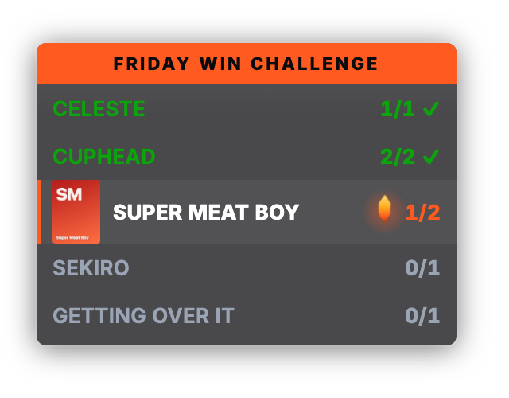
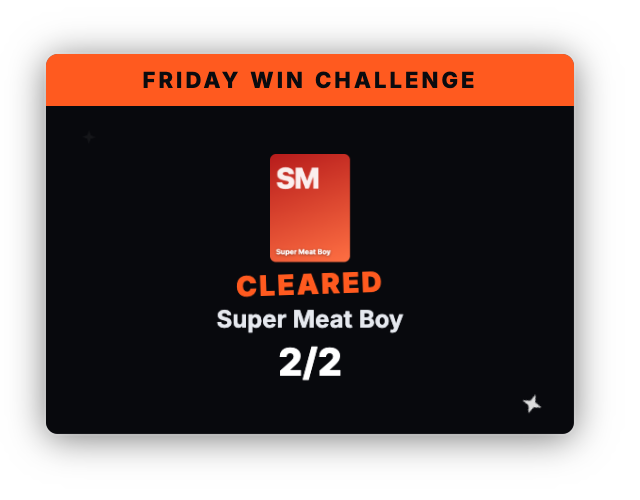
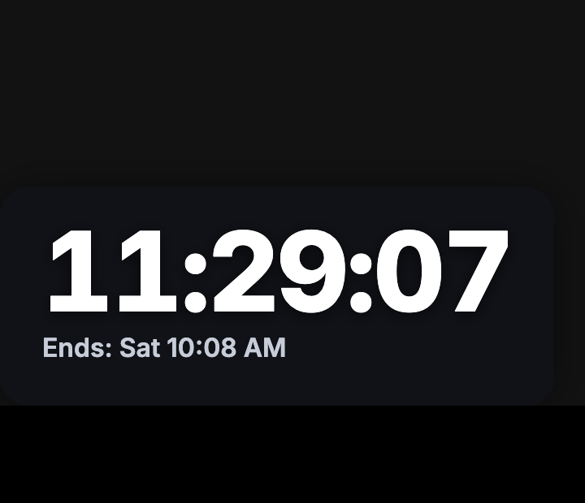
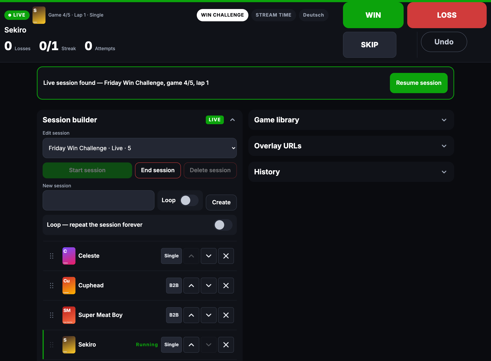
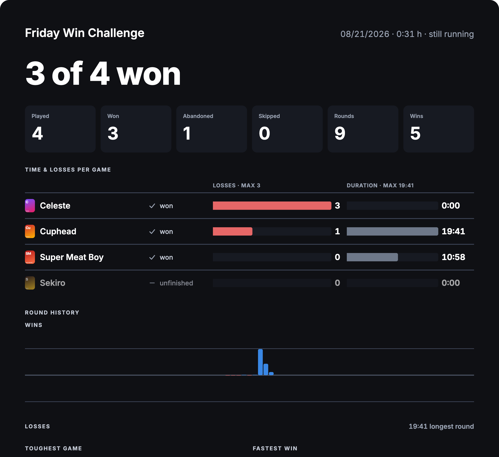

# twitch-win-challenge

[](LICENSE)

A self-hosted overlay and control panel for Twitch **win challenges** (beat every game on a
list, in order, live on stream), plus an optional donation-driven **subathon clock**. Runs
entirely on your own Cloudflare account (Workers, D1, R2); the free tier covers a busy stream
with room to spare.



## What it does

The streamer plays through a list of games and must meet a win condition in each before moving
on: one win for a normal game, back-to-back wins for a `B2B` one. The OBS overlay shows the
audience the whole lap: what's done, what's next, and how hot the current streak is. Losses
deliberately never appear on camera; they live in the admin panel, the recap, and the exports.

You control the run three ways, and they can be mixed freely mid-stream:

- **Stream Deck buttons**: plain URL presses for win / loss / skip / undo, so you never
  alt-tab out of the game.
- **A phone-first admin panel**: big controls at the top, session building, a game library
  with IGDB search and cover art, live reordering, history with recaps and exports.
- **The same admin on desktop** for setup and everything fiddly.

Every action is an event in an append-only log. That is the load-bearing design decision:
undo is real (it re-derives state, never "subtracts one"), a crashed server rebuilds mid-run
state from the log, and the end-of-stream recap is computed from the same events the overlay
was painted from. The numbers cannot disagree.

| | |
|---|---|
|  |  |





## Features

- **Compact list overlay** (264px wide): the whole lap at a glance, streak counter per game,
  cover art on the current game, a finite flame on hot streaks, comic-sticker celebration
  beats on wins. Measured at ~0.01% CPU in the browser source, and built for 40-hour streams.
- **Single and back-to-back (B2B) win conditions**, switchable per game, editable mid-run.
- **Loop mode**: the list repeats until you stop it, with a "stop after this game" latch.
- **Real undo**: one press reverses one action, even across a game boundary.
- **Mid-run editing**: insert, remove and reorder games while live; replay-safe by design.
- **Game library with IGDB search**: covers are ingested into your own R2 bucket, never
  hotlinked. Works fine without IGDB credentials too (manual entry, optional cover upload).
- **End-of-stream recap**: KPI tiles, per-game time & losses, round history, per-lap
  breakdown, JSON/CSV export. Doubles as an OBS scene.
- **Subathon clock**: a countdown that GoFundMe donations extend, with per-donation
  exclusions, manual corrections, Twitch auto-pause, and its own overlay. See
  [docs/OPERATIONS.md](docs/OPERATIONS.md#the-subathon-clock) before relying on it: it reads
  an undocumented GoFundMe endpoint and degrades to manual operation when that breaks.
- **English and German**, switchable per overlay (`?lang=`) and per admin (a toggle in the
  nav). Every user-facing string lives in one file; adding a language is completing
  [public/strings.js](public/strings.js).
- **Two independent bearer tokens**: the overlay URL (read-only, safe-ish to leak) and the
  control URL (fires actions, keep it secret). Rotating either takes one click. The admin
  sits behind Cloudflare Access *plus* independent JWT verification in the Worker. The full
  reasoning is in [SECURITY.md](SECURITY.md).

## How it's built

```
Cloudflare Worker (one)
├── Durable Object "LiveRun"    ← source of truth for live state; WebSocket fan-out
│                                 to overlay + admin; appends every event to D1
├── Durable Object "TimerRun"   ← the subathon clock (own state, own lifecycle)
├── D1                          ← append-only event log + config. All history.
├── R2                          ← cover art
└── Workers Assets              ← the frontend, served as plain static files
```

No frontend framework, no bundler, one backend dependency (`jose`, for JWT verification).
`public/` is hand-written ES modules and CSS served verbatim. That is a hard constraint, not
an aesthetic: the overlay lives inside OBS's browser source with a strict CPU budget, and the
smallest, most predictable payload is the one with no transform between source and wire.

The deeper design docs: [docs/SPEC.md](docs/SPEC.md) (behaviour, state machine, protocol),
[docs/DESIGN.md](docs/DESIGN.md) (the visual contract), [docs/OPERATIONS.md](docs/OPERATIONS.md)
(the runbook).

## Setup from zero

You need: a Cloudflare account (free tier is fine), a domain on that account (the admin's
security model requires a custom domain; the FAQ explains why), Node 24+, and about half an
hour.

```bash
git clone https://github.com/derFrisson/twitch-win-challenge
cd twitch-win-challenge
npm install
npx wrangler login
```

**1. Create the database and the bucket** (both are one-time API calls):

```bash
npx wrangler d1 create twitch-win-challenge-db
npx wrangler r2 bucket create twitch-win-challenge-covers
```

**2. Edit the three `EDIT ME` lines in [wrangler.jsonc](wrangler.jsonc):** your account id,
the `database_id` the create command just printed, and the hostname you want to serve on
(e.g. `stream-tool.your-domain.com`). If you'd rather keep those values out of your working
tree, keep a filled-in copy as `wrangler.local.jsonc` (gitignored) and pass
`--config wrangler.local.jsonc` to wrangler commands.

**3. Apply the schema:**

```bash
npm run migrate:remote     # production D1
npm run migrate:local      # local replica, for `npm run dev`
```

**4. Create the Cloudflare Access application** (this is what puts a login wall in front of
the admin):

1. Zero Trust dashboard → Access → Applications → *Add an application* (self-hosted).
2. Domain: your hostname from step 2, paths `/admin*` **and** `/api/admin*`. Both; they are
   separate prefixes, and a policy on only one leaves the other exposed.
3. Add a policy (e.g. "email is you@example.com").
4. Copy the application's **AUD tag**. You need it in the next step.

**5. Set the secrets:**

```bash
npx wrangler secret put CF_TEAM_DOMAIN    # your-team.cloudflareaccess.com
npx wrangler secret put CF_ACCESS_AUD     # the AUD tag from step 4
npx wrangler secret put IGDB_CLIENT_ID    # optional: cover-art search
npx wrangler secret put IGDB_CLIENT_SECRET
```

The IGDB pair is a Twitch developer application's credentials
([how to get them](https://api-docs.igdb.com/#account-creation)). Without them everything
works except cover search: add games manually and upload covers by hand, or skip art
entirely.

**6. Deploy and open it:**

```bash
npm run deploy             # runs the checks first, then wrangler deploy
```

Open `https://<your-host>/admin/`, log in through Access, and the first-run screens walk you
through the rest: add games to the library, build a session, start it, and copy the overlay
URL into OBS.

**If the admin answers 401 right after deploying**, that is the fail-closed design working:
`CF_TEAM_DOMAIN` or `CF_ACCESS_AUD` is missing or wrong. A misconfigured deploy locks the
admin rather than exposing it.

### Local development

```bash
cp .dev.vars.example .dev.vars   # dummy values are fine
npm run migrate:local
npm run dev                      # http://localhost:8787, no Access needed locally
```

## OBS setup

Add a **Browser Source** per widget (overlay, and optionally the recap and the clock):

| Setting | Value | Why |
|---|---|---|
| URL | from the admin panel's *Overlay URLs* section | It builds the URL with your preview settings and gives you copy buttons. |
| Width / Height | the **native** size you render the source at | Browser-source cost scales with the source's own pixel size, not its on-canvas size. |
| Shutdown source when not visible | **OFF** | ON destroys the page (and its WebSocket) on every scene switch. |
| Refresh browser when scene becomes active | **OFF** | Same cost, no benefit, on every switch. |
| Control audio via OBS | **ON** if you use `?sfx=1` | Also assign the source's audio to a track in Advanced Audio Properties, or it goes nowhere. |
| Custom CSS | leave OBS's default | Both sides already agree on a transparent background. |
| Hardware acceleration (global setting) | test on your machine | Some GPUs need it ON for smooth animation, others corrupt the render with it ON. Watch a streak flame for a few minutes before trusting either setting. |

The overlay is deliberately **invisible while no session is live**. A blank scene is correct
on camera; start a session to see it.

## Stream Deck setup

Use the **Website** action, one button per row, with the **background request** option
enabled. Without it, every press opens a browser window on top of your game.

| Button | URL |
|---|---|
| Win | `https://<your-host>/c/<control-token>/win` |
| Loss | `https://<your-host>/c/<control-token>/loss` |
| Skip | `https://<your-host>/c/<control-token>/skip` |
| Undo | `https://<your-host>/c/<control-token>/undo` |
| Stop after current | `https://<your-host>/c/<control-token>/stop-loop` |

Copy-ready URLs for all of these are in the admin panel's *Overlay URLs* section. `next`
exists as an alias of `skip` if you prefer that label. `stop-loop` only ever *sets* the latch
(a hotkey that toggles hidden state is a live-stream bug); clear it from the admin panel.

The control URL can fire wins and losses, so treat it like a password. It is a different
token from the overlay URL precisely so the URL that sits in OBS can leak without handing
anyone your buttons. Rotating either token (admin panel) invalidates the old URL immediately.

## Query parameters

Append to the overlay URL; invalid values fall back silently. The admin's live preview builds
these for you.

| Param | Default | Range | What it does |
|---|---|---|---|
| `scale` | `1` | `0.5-2.0` | Overall size (a transform, so it costs nothing at render time) |
| `opacity` | `0.85` | `0.30-1.00` | Panel fill only; text and art stay fully opaque |
| `accent` | `ff5a1f` | 6-digit hex | Accent colour (header, streak, flame) |
| `grad` | off | `RRGGBB-RRGGBB[-RRGGBB]` | Header gradient instead of the flat accent |
| `pos` | `bl` | `tl tc tr bl bc br` | Which corner/edge the panel anchors to |
| `lang` | `en` | `en de` | Overlay language |
| `sfx` | `0` | `0 1` | Sound effects (see the note below) |
| `vol` | `0.5` | `0.0-0.8` | SFX volume |
| `mono` | `0` | `0 1` | White accent, the escape hatch when the accent fights the game |

The recap page accepts `?session=<id>` (default: the live session, else the newest ended
one). The clock widget accepts `scale`, `opacity`, `accent`, `pos`, `lang`, `goal=1` for
a goal bar, and `vol` (`0.0-0.8`, default `0.5`) for the donation sound — a custom sound
uploaded in its admin page and played whenever a poll detects a new donation (`vol=0` mutes).

**About `?sfx=1`:** the three files in `public/sfx/` are valid but silent placeholders.
Replace them with your own sounds before turning sound on; see
[docs/OPERATIONS.md](docs/OPERATIONS.md#what-you-still-need-to-supply).

## Languages

English is the default. German is complete and ships in the same file. The overlay and clock
pin their language in the URL (`?lang=de`); the admin pages have a toggle in the nav and
remember the choice. All copy (labels, tooltips, errors, both languages) lives in
[public/strings.js](public/strings.js), and adding a language is completing every key in one
new object there. No i18n framework, deliberately.

## The subathon clock

A second, independent tool in the same Worker: a countdown that donations to a GoFundMe
campaign extend. It has its own overlay (`/o/<token>/timer`), its own admin page
(`/admin/timer/`), its own Stream Deck endpoints (`timer-pause`, `timer-resume`, `plus1h`),
and it keeps running when no win-challenge session exists.

The clock is **derived, never stored**: earned time is computed from base + donations ÷ rate
(capped), consumed time is folded from the pause/resume log, and the remainder survives OBS
reloads, redeploys and reboots by construction. Everything about the money model (rate, base
hours, cap, per-donation "counts for time" toggles, manual corrections) is a live-editable
field in its admin page.

Both admin pages carry **simulation buttons** (win-challenge admin: under the preview;
clock admin: in the donation-sound section) that rehearse an event on every connected
overlay — a win, the game-won takeover, a loss, or a donation with toast, sound and time
jump. The overlay plays the beat for a few seconds and snaps back to the real state on its
own; nothing is stored and no counter moves.

**Read [the operations guide](docs/OPERATIONS.md#the-subathon-clock) before a real subathon.**
The GoFundMe data source is an unofficial endpoint that can change without notice; the clock
is built to degrade to fully manual operation when it does, and there is an honest list of
what has never been tested against live services.

## Verifying a checkout

```bash
npm run check
```

That runs three gates: `tsc --noEmit` (strict, no suppressions), the test suite
(75 `node --test` assertions over the state machine, the clock math, and the GoFundMe
parser, with no framework and no network), and `verify:dce`, which builds the production
bundle and proves the dev-mode auth bypass was dead-code-eliminated out of it (the bypass
string is physically absent, not merely "unreachable").

The overlay's CPU budget is a hard gate too: **≤3% CPU with zero layout and zero style
recalc**, measured over a 20-second window in headless Chrome at 1080p. The shipped build
measures **0.011% at rest and 0.005% with a streak lit**. The flame animates three pulses
when a streak starts, then holds still, because *any* continuously animating element costs
~3% regardless of what it draws. If you touch `public/overlay.*`, re-measure (the method is
in [docs/SPEC.md](docs/SPEC.md) §7.6) and include the numbers in your PR.

Headless Chrome is a directional proxy, not OBS: for a true in-OBS number, toggle the source
and read the `obs-browser-page` process in Task Manager / Activity Monitor.

## FAQ

**The overlay is blank in OBS.** If no session is live, that's by design. If one is live,
check the URL against the admin's *Overlay URLs* section; a rotated token invalidates old
URLs immediately.

**Covers don't load.** IGDB credentials are missing or wrong (`wrangler secret put
IGDB_CLIENT_ID` / `IGDB_CLIENT_SECRET`). Games added while search was broken heal themselves:
the admin repairs missing covers on page load once credentials work.

**Can someone with my overlay URL mess with the run?** No; it is read-only. The control URL
is the one to protect. Both, and what happens if they leak, are covered in
[SECURITY.md](SECURITY.md).

**Why does the admin need a custom domain? Can't I use `workers.dev`?** The Access
application only covers the routed hostname, so `workers_dev` (and preview URLs) are switched
off deliberately. On an unrouted hostname the Worker would still answer 401, but the right
number of ways around the login wall is zero.

**Something looks wrong mid-stream.** Press *Resume session* in the admin (or POST
`/api/admin/control/rehydrate`): it rebuilds live state from the database and re-broadcasts.
Nothing is lost. The log is the truth; the cache is disposable.

**Where did my numbers go after a crash/redeploy?** Nowhere: state rebuilds from D1 on the
next request. This path is tested by deleting the Durable Object's storage outright and
watching it recover.

## License

[GPL-3.0](LICENSE). If you distribute a modified version, share your changes the same way.
